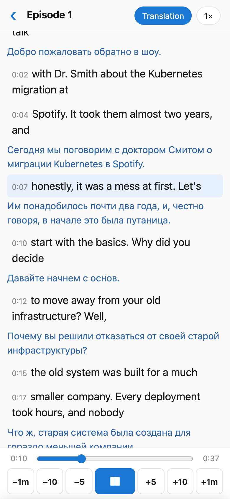
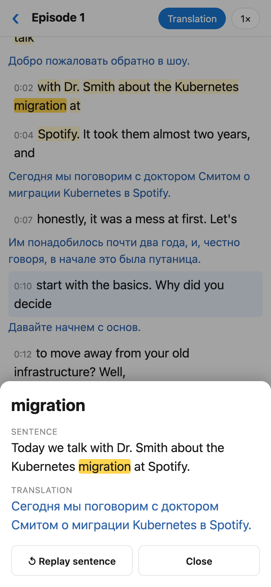

# offline-listen

Listen to foreign-language podcasts and audiobooks on your iPhone, **offline**, with
synced subtitles and a translation one tap away.

<p>
  
  &nbsp;
  
</p>

- The current line is highlighted, and the list follows playback.
- Tap any word: playback pauses and you see the whole sentence with its translation.
  Tap “↺ Replay sentence” to hear it again.
- Skip buttons for ±5 s, ±10 s and ±1 min; speed from 0.75× to 1.5×. The app remembers
  where you stopped in each episode.
- Plays in the background and from the lock screen.
- No server and no account. Your audio stays on your phone.

**Player:** <https://konoplev.github.io/offline-listen/>

## How it works

```
 Mac                                         iPhone
 ┌──────────────────────────────┐            ┌─────────────────────────────┐
 │ listen-gen ~/Podcasts/show   │  AirDrop / │ Listen (web app on the Home │
 │   mlx-whisper → subtitles    │  iCloud    │ Screen, works offline)      │
 │   macOS translator → ru      │ ─────────▶ │   ＋ Add → X.mp3 + X.json   │
 │   writes X.json next to X.mp3│  → Files   │                             │
 └──────────────────────────────┘            └─────────────────────────────┘
```

There are two parts:

1. **`generator/`** is `listen-gen`, a command-line tool for Apple Silicon Macs.
   - It transcribes every audio file in a folder with [mlx-whisper](https://github.com/ml-explore/mlx-examples/tree/main/whisper).
   - It splits the text into short lines (8 words or 5 seconds) and into sentences.
   - It translates each sentence with the **built-in macOS translator**, which is
     free and runs on your Mac.
   - Optionally, an LLM can fix recognition errors (`--fix`) or do the translation
     (`--translator llm`).
2. **`player/`** is a static web app (PWA), published with GitHub Pages.
   - You open it once in Safari and add it to the Home Screen.
   - After that it works without internet.
   - Episodes you import are stored on the phone.

## Install the player on iPhone

1. Open **<https://konoplev.github.io/offline-listen/>** in **Safari**. It has to be
   Safari, because other browsers on iOS can't add web apps to the Home Screen.
2. Tap the **Share** button (the square with an arrow), then **Add to Home Screen**,
   then **Add**.
3. Start **Listen** from the Home Screen icon. From now on it works offline, including
   in airplane mode.

To try it right away, download the sample episode,
[`Episode 1.mp3`](https://konoplev.github.io/offline-listen/tests/e2e/fixtures/Episode%201.mp3) and
[`Episode 1.json`](https://konoplev.github.io/offline-listen/tests/e2e/fixtures/Episode%201.json), to Files and add both.

> **Notes**
> - Always start the app from the Home Screen icon. The Home Screen app and the Safari
>   tab have separate storage, so episodes added in one don't show up in the other.
> - New versions of the player arrive on the second launch after a release, because
>   the first launch shows the cached copy and updates it in the background.
> - iOS can remove data of web apps that you haven't opened for a long time. Keep
>   `X.mp3` and `X.json` in Files (or on your Mac) so you can add them again.

## Add episodes

1. On the Mac, run `listen-gen` on a folder of audio files (see below). It writes
   `X.json` next to each `X.mp3`.
2. Copy both files to the iPhone. You can:
   - AirDrop them and choose **Save to Files**, or
   - put them in iCloud Drive, or
   - drag them into the phone in Finder.
3. In Listen, tap **＋ Add**, then select **both** `X.mp3` and `X.json` (tap **Select**
   in the top right corner of Files to pick several files). You can add several
   episodes at once.

The audio is copied into the app, so you can delete the files from Files afterwards.

## Generator

### Requirements

- A Mac with Apple Silicon and **macOS 26** with **Xcode**. A small Swift helper for the
  macOS translator is compiled on first run.
- Python 3.11+ and [uv](https://docs.astral.sh/uv/).
- The **translation languages**: go to **System Settings → General → Language & Region →
  Translation Languages** and download both languages (English and Russian by default).
- An mlx-whisper model in your local Hugging Face cache. The default is
  `mlx-community/whisper-large-v3-mlx`. `listen-gen` never downloads models, so get one
  first:
  ```bash
  .venv/bin/python -c "from huggingface_hub import snapshot_download as d; d('mlx-community/whisper-large-v3-mlx')"
  ```
- `OPENAI_API_KEY`, needed only for `--fix` and `--translator llm`. You can also use
  Ollama or any OpenAI-compatible server with `--base-url`.

### Install

```bash
git clone https://github.com/konoplev/offline-listen.git
cd offline-listen
uv venv --python 3.12 .venv
uv pip install --python .venv/bin/python -e 'generator[dev]'
```

### Run

```bash
.venv/bin/listen-gen ~/Podcasts/some-show
```

For every `X.mp3` in the folder (also m4a, aac, wav, flac, ogg and opus), it writes:

| file | contents |
|---|---|
| `X.json` | everything the player needs: lines, sentences and translations |
| `X.srt` | the transcript in short lines (8 words or 5 s); fixed by the LLM if you use `--fix` |
| `X.ru.srt` | the translation, one entry per sentence |
| `.listen-cache/` | intermediate results, so a failed run resumes where it stopped |

Files that already have `X.json` are skipped.

| option | meaning |
|---|---|
| `--src en` `--tgt ru` | audio language and translation language |
| `--whisper <model>` | the mlx-whisper model, taken from the local cache |
| `--translator apple\|llm` | the macOS translator (default, free) or an LLM |
| `--fix` | let an LLM fix recognition errors before translating (off by default) |
| `--hint "…"` | what the audio is about, names and terms; helps `--fix` |
| `--model gpt-4o-mini` `--base-url URL` `--workers 4` | LLM settings |
| `--force` | redo the fix and the translation (whisper output comes from the cache) |
| `--retranscribe` | also run whisper again |

Example: German audio with a Ukrainian translation, fixed and translated by a local
Ollama model:

```bash
.venv/bin/listen-gen ~/Audio/hoerbuch --src de --tgt uk --fix --translator llm \
  --model qwen2.5:14b --base-url http://localhost:11434/v1 --hint "Krimi, names: Kluftinger"
```

## Development

The player is plain HTML, CSS and JS, with no build step:

```bash
cd player && python3 -m http.server 8000     # http://localhost:8000
```

Bump `VERSION` in `player/sw.js` whenever you change player files; otherwise installed
apps keep the cached copy. GitHub Pages serves the `gh-pages` branch; to publish
the current `player/`, run:

```bash
git push origin "$(git subtree split --prefix player main)":refs/heads/gh-pages --force
```

Tests:

```bash
cd generator && ../.venv/bin/pytest           # add -m "not slow" to skip real whisper/macOS translation
cd player && node --test tests/*.test.js      # player logic
cd player && ../.venv/bin/pytest              # end-to-end in your installed Google Chrome (Playwright)
```

All test scenarios and their results are listed in [docs/scenarios.md](docs/scenarios.md).

## License

[MIT](LICENSE)
